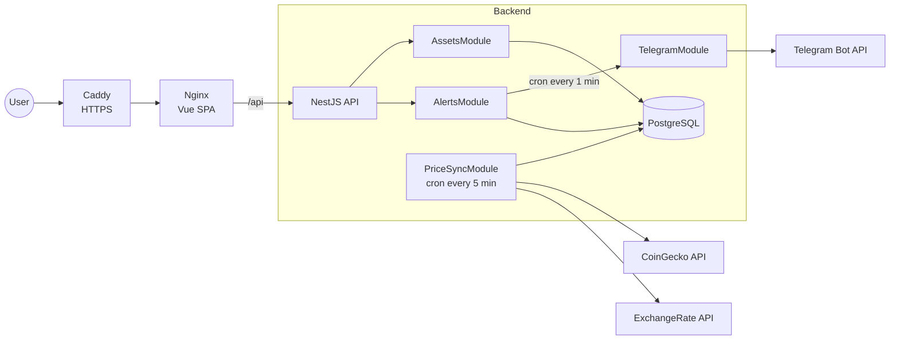
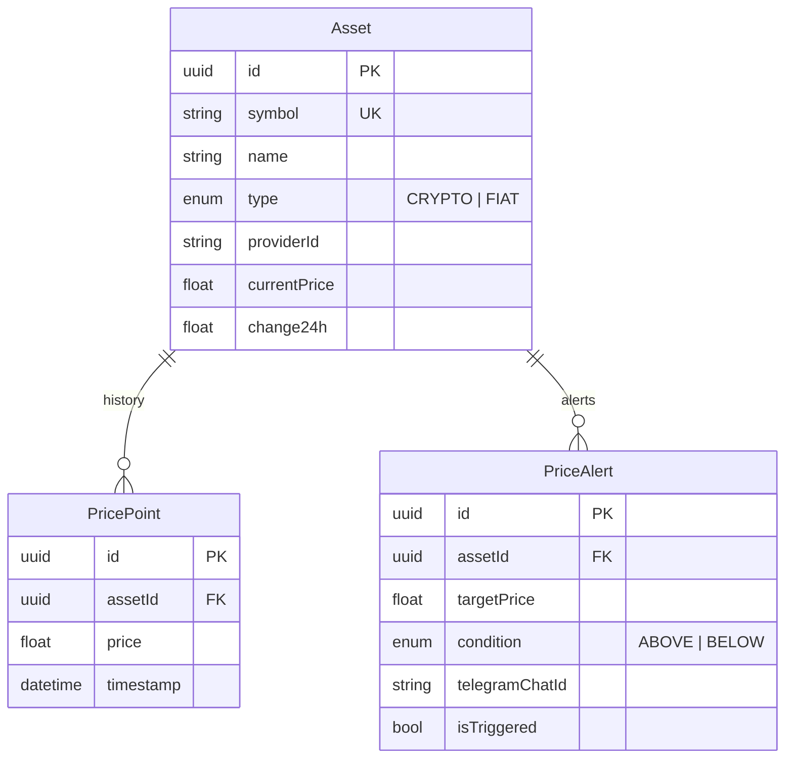

# ApexRate — Currency & Crypto Price Aggregator with Telegram Alerts

**English** | [Русский](README.ru.md)


Every 5 minutes the service pulls crypto prices (CoinGecko) and fiat exchange rates (ExchangeRate API), stores the price history in PostgreSQL, serves it over a REST API for charts, and sends a Telegram notification when a price crosses a user-defined threshold.

> **My contribution.** I built the backend (`/backend`) and the infrastructure (Docker, CI/CD, deployment) from a technical specification. The frontend (`/frontend`) was generated by an AI agent and serves as a client for the API.


<!--**Demo:** https://apexrate.example.com-->

## Contents

- [Features](#features)
- [Architecture](#architecture)
- [Tech stack](#tech-stack)
- [Getting started](#getting-started)
- [Environment variables](#environment-variables)
- [API](#api)
- [Project structure](#project-structure)
- [Testing](#testing)
- [Deployment](#deployment)
- [Design decisions](#design-decisions)
- [Roadmap](#roadmap)
- [License](#license)

## Features

- **Asset tracking** — cryptocurrencies (BTC, ETH, SOL and any coin listed on CoinGecko) and USD currency pairs (EUR, UYU, etc.).
- **Validation on create** — a new asset is checked against the external provider, so an unknown ticker never reaches the database.
- **Price history** — every sync stores a price point; the API returns history for 1 hour, 24 hours and 7 days.
- **24h change** — taken from CoinGecko for crypto, calculated from the stored history for fiat.
- **Price alerts** — `ABOVE` / `BELOW` conditions, checked every minute, delivered via the Telegram Bot API; each alert fires once.
- **API docs** — Swagger UI in development mode.

## Architecture



**Data flow:**

1. `PriceSyncService` fetches crypto and fiat prices in parallel every 5 minutes (`Promise.allSettled` — one provider failing does not block the other).
2. For each asset, the current price is updated and a `price_points` row is created in a single transaction.
3. `AlertsService` runs every minute: it loads pending alerts, compares them with the current price, marks the matching ones as triggered and sends a Telegram message.

### Data model



A composite index on `price_points (assetId, timestamp)` speeds up time-range history queries. Deleting an asset cascades to its history and alerts.

## Tech stack

| Layer | Technologies |
|---|---|
| Backend | NestJS 11, TypeScript, Prisma 7 (`@prisma/adapter-pg`), PostgreSQL 16, `@nestjs/schedule`, `@nestjs/axios`, `class-validator`, Swagger |
| Integrations | CoinGecko API, ExchangeRate API, Telegram Bot API |
| Testing | Jest, ESLint, Prettier |
| Frontend | Vue 3, Vite, Pinia, Tailwind CSS, Chart.js *(AI-generated)* |
| Infrastructure | Docker (multi-stage builds), Docker Compose, Nginx, Caddy, GitHub Actions, GHCR |

## Getting started

**Requirements:** Docker and Docker Compose. For local development without Docker: Node.js 22+ and pnpm.

### Option 1. Everything in Docker

```bash
git clone https://github.com/Sinonaz/apexrate-currency-aggregator.git
cd apexrate-currency-aggregator

cp .env.example .env          # set the DB password, TELEGRAM_BOT_TOKEN and COINGECKO_API_KEY
docker compose up -d --build

# Seed demo assets with 7 days of price history
docker compose exec backend node dist/prisma/seed.js
```

The app is available at [http://localhost](http://localhost). Migrations are applied automatically when the backend container starts.

### Option 2. Local development

```bash
# 1. Database
cd backend
docker compose up -d           # PostgreSQL on localhost:5433

# 2. Backend
cp .env.example .env
pnpm install
pnpm prisma migrate dev
pnpm seed
pnpm start:dev                 # http://localhost:3000/api

# 3. Frontend (in another terminal)
cd ../frontend
cp .env.example .env
pnpm install
pnpm dev                       # http://localhost:5173
```

Swagger UI: [http://localhost:3000/api/docs](http://localhost:3000/api/docs) (disabled in production).

> The frontend can run without the backend in **Mock Mode** — use the toggle in the UI or set `VITE_MOCK_MODE=true`.

## Environment variables

### Backend (`backend/.env`)

| Variable | Required | Description |
|---|---|---|
| `DATABASE_URL` | yes | PostgreSQL connection string |
| `PORT` | no | API port, defaults to `3000` |
| `TELEGRAM_BOT_TOKEN` | yes | Bot token from [@BotFather](https://t.me/BotFather) |
| `COINGECKO_API_URL` | yes | CoinGecko base URL, e.g. `https://api.coingecko.com/api/v3/` |
| `COINGECKO_API_KEY` | yes | CoinGecko demo API key |
| `FIAT_API_URL` | yes | ExchangeRate API base URL, e.g. `https://open.er-api.com/v6/` |
| `NODE_ENV` | no | `production` disables Swagger and CORS |

### Project root (`.env` for Docker Compose)

| Variable | Description |
|---|---|
| `POSTGRES_USER`, `POSTGRES_PASSWORD`, `POSTGRES_DB` | PostgreSQL credentials |
| `TELEGRAM_BOT_TOKEN` | Telegram bot token |
| `COINGECKO_API_KEY` | CoinGecko demo API key |
| `COINGECKO_API_URL`, `FIAT_API_URL` | Optional, default to the providers' public URLs |

### Frontend (`frontend/.env`)

| Variable | Description |
|---|---|
| `VITE_API_URL` | API URL, defaults to `http://localhost:3000/api` |
| `VITE_MOCK_MODE` | `true` starts the UI with mock data |

## API

All endpoints are prefixed with `/api`. Input is validated by a global `ValidationPipe` (`whitelist`, `transform`), and errors are returned in a single consistent format.

| Method | Path | Description |
|---|---|---|
| `GET` | `/assets` | List tracked assets |
| `POST` | `/assets` | Add an asset (validated against the provider) |
| `DELETE` | `/assets/:id` | Delete an asset with its history and alerts |
| `GET` | `/assets/:id/history?timeframe=1h\|24h\|7d` | Price history |
| `GET` | `/alerts` | List alerts |
| `POST` | `/alerts` | Create an alert |
| `DELETE` | `/alerts/:id` | Delete an alert |

<details>
<summary>Request examples</summary>

```bash
# Add a cryptocurrency
curl -X POST http://localhost:3000/api/assets \
  -H 'Content-Type: application/json' \
  -d '{"symbol":"DOGE","name":"Dogecoin","type":"CRYPTO","providerId":"dogecoin"}'

# Add the USD/GBP pair
curl -X POST http://localhost:3000/api/assets \
  -H 'Content-Type: application/json' \
  -d '{"symbol":"USD/GBP","name":"British Pound","type":"FIAT","providerId":"gbp"}'

# Alert: notify me when BTC goes above $100,000
curl -X POST http://localhost:3000/api/alerts \
  -H 'Content-Type: application/json' \
  -d '{"assetId":"<uuid>","assetSymbol":"BTC","targetPrice":100000,"condition":"ABOVE","telegramChatId":"<chat_id>"}'
```

Error format:

```json
{
  "statusCode": 409,
  "timestamp": "2026-10-28T12:00:00.000Z",
  "path": "/api/assets",
  "message": "Asset with symbol \"BTC\" already exists",
  "error": "Conflict"
}
```

</details>

> To find your `telegramChatId`, message [@userinfobot](https://t.me/userinfobot). Send `/start` to your own bot before expecting alerts.

## Project structure

```
.
├── backend/
│   ├── prisma/               # schema and migrations
│   └── src/
│       ├── assets/           # asset CRUD, price history
│       ├── alerts/           # alerts and the cron condition check
│       ├── price-sync/       # cron sync with CoinGecko and ExchangeRate API
│       ├── telegram/         # notification delivery
│       ├── prisma/           # PrismaService, seed
│       └── filters/          # global HTTP exception filter
├── frontend/                 # Vue 3 SPA + nginx (proxies /api to the backend)
├── deploy/                   # server bootstrap, shared infra (Caddy + PostgreSQL), deploy guide
├── docker-compose.yaml       # run the whole stack locally
├── docker-compose.prod.yaml  # production: images from GHCR
└── .github/workflows/        # CI/CD
```

## Testing

```bash
cd backend
pnpm test          # unit tests (Jest)
pnpm lint:check    # ESLint + Prettier
```

The tests cover the core business logic: `ABOVE` / `BELOW` alert triggering (including boundary values), asset validation and deduplication, handling of the `P2002` race condition, and history time ranges.

## Deployment

On every push to `main`, GitHub Actions:

1. Runs lint, unit tests and the backend build; deployment does not start if any of them fail.
2. Builds the backend and frontend Docker images (matrix build, layer cache via GHA).
3. Pushes them to GitHub Container Registry tagged `latest` and `<commit sha>`.
4. Copies `docker-compose.prod.yaml` to the VPS over SSH, pulls the images and restarts the services, waiting for healthchecks (`docker compose up -d --wait`).

In production the project runs on top of a shared infra stack (`deploy/infra`) used by all projects on the server: one Caddy (automatic HTTPS) and one PostgreSQL instance where each project has its own role and database. Caddy reaches the frontend over the external `proxy` Docker network, the backend reaches PostgreSQL over the external `db` network; neither the backend nor the database publish ports. Nginx inside the frontend container serves the SPA and proxies `/api` to the backend, so the frontend and the API share one origin and CORS is not needed.

Repository secrets: `SERVER_HOST`, `SERVER_USER`, `SSH_KEY`. The server needs `/srv/apexrate/.env`. Step-by-step server setup (in Russian): [deploy/README.md](deploy/README.md).

## Design decisions

- **Two HTTP clients via DI tokens.** CoinGecko and ExchangeRate API have different base URLs and headers, so each provider gets its own `HttpService` instance registered with `useFactory` and `ConfigService`.
- **Provider failure isolation.** Crypto and fiat sync run through `Promise.allSettled`; errors are logged and never crash the cron job.
- **Atomic price writes.** Updating `currentPrice` and creating the `PricePoint` happen in one Prisma transaction.
- **24h change for fiat.** ExchangeRate API does not provide a daily change, so it is calculated from the closest stored price point older than 24 hours.
- **Duplicate protection.** Before creating an asset, uniqueness of `symbol` and of the `providerId + type` pair is checked; concurrent inserts are caught by the Prisma `P2002` code and returned as `409 Conflict`.
- **Multi-stage Dockerfile**, with `prisma migrate deploy` on container start.

## Roadmap

- [ ] API e2e tests (Supertest + a test PostgreSQL instance)
- [ ] Authentication and per-user alerts
- [ ] Telegram bot commands (`/start`, `/alerts`) instead of entering the chat id manually
- [ ] Store prices as `Decimal` instead of `Float`
- [ ] Retention / downsampling of old price history
- [ ] `/health` endpoint for healthchecks

## License

[MIT](LICENSE)
