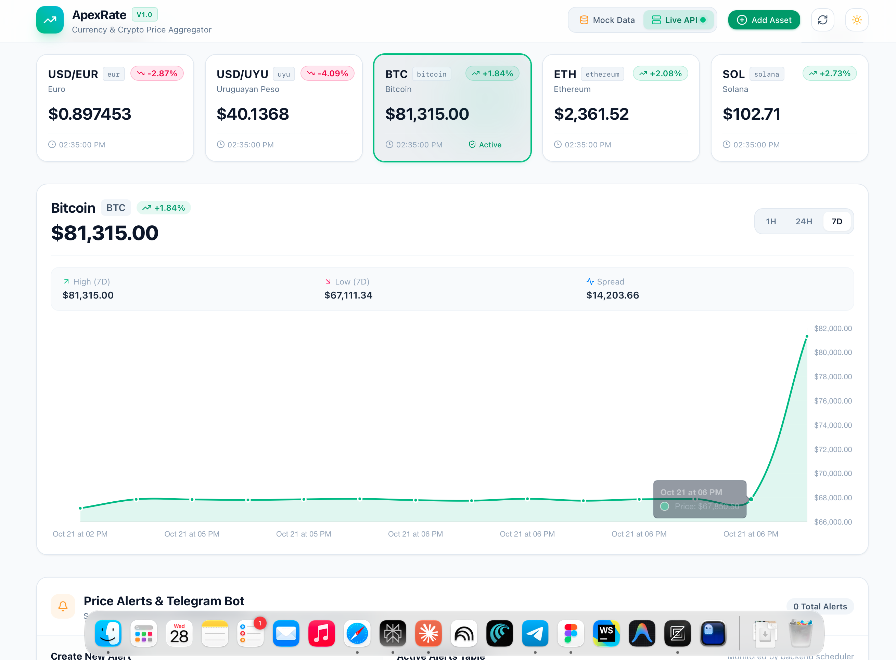
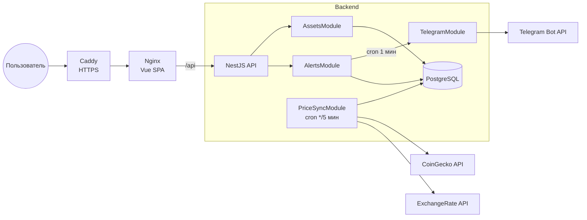
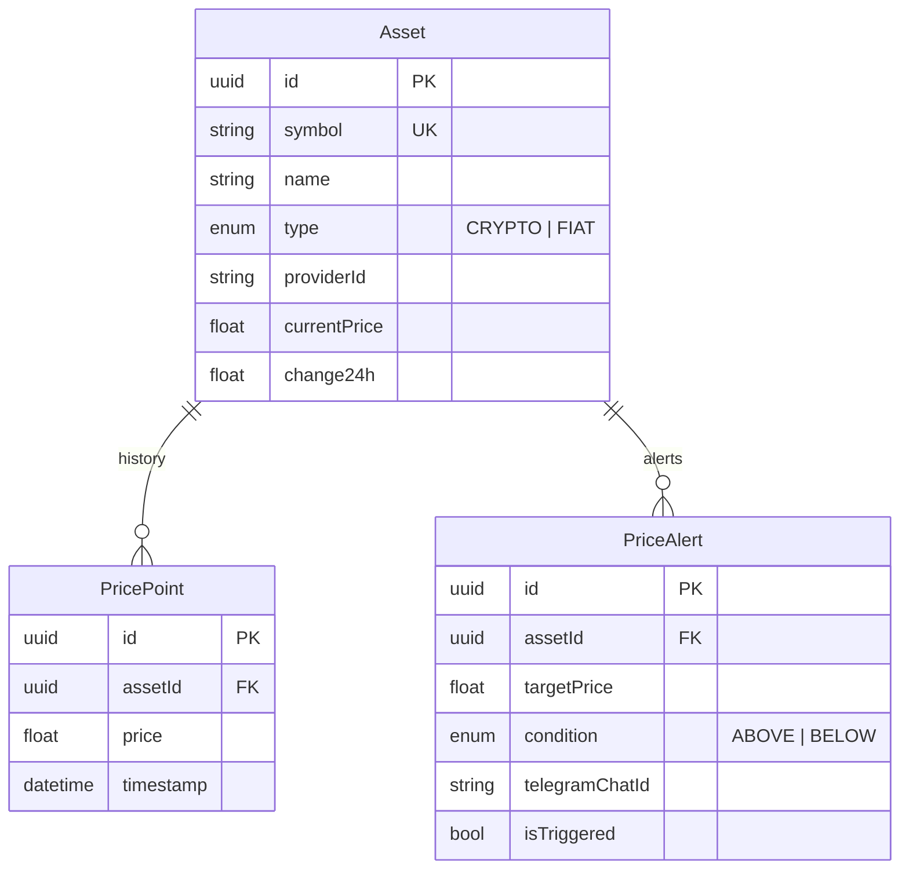

# ApexRate — агрегатор курсов валют и криптовалют с Telegram-алертами

[English](README.md) | **Русский**


Сервис раз в 5 минут собирает котировки криптовалют (CoinGecko) и фиатных валют (ExchangeRate API), хранит историю цен в PostgreSQL, отдаёт её по REST API для графиков и отправляет уведомление в Telegram, когда цена пересекает заданный пользователем порог.

> **Мой вклад.** Бэкенд (`/backend`), инфраструктура (Docker, CI/CD, деплой) написаны мной по техническому заданию. Фронтенд (`/frontend`) сгенерирован ИИ-агентом и служит клиентом для API.


<!--**Демо:** https://apexrate.example.com-->

## Содержание

- [Возможности](#возможности)
- [Архитектура](#архитектура)
- [Стек](#стек)
- [Быстрый старт](#быстрый-старт)
- [Переменные окружения](#переменные-окружения)
- [API](#api)
- [Структура проекта](#структура-проекта)
- [Тесты](#тесты)
- [Деплой](#деплой)
- [Технические решения](#технические-решения)
- [Планы](#планы)
- [Лицензия](#лицензия)

## Возможности

- **Отслеживание активов** — криптовалюты (BTC, ETH, SOL и любые монеты из CoinGecko) и валютные пары к USD (EUR, UYU и т. д.).
- **Валидация при добавлении** — новый актив проверяется у внешнего провайдера; несуществующий тикер не попадёт в базу.
- **История цен** — каждая синхронизация сохраняет точку цены; API отдаёт историю за 1 час, 24 часа и 7 дней.
- **Изменение за 24 часа** — для крипты берётся из CoinGecko, для фиата вычисляется по собственной истории в БД.
- **Ценовые алерты** — условия `ABOVE` / `BELOW`; проверка раз в минуту, уведомление через Telegram Bot API, алерт срабатывает один раз.
- **Документация API** — Swagger UI в режиме разработки.

## Архитектура



**Поток данных:**

1. `PriceSyncService` каждые 5 минут параллельно запрашивает цены крипты и фиата (`Promise.allSettled` — сбой одного провайдера не блокирует другой).
2. Для каждого актива в одной транзакции обновляется текущая цена и создаётся запись в `price_points`.
3. `AlertsService` раз в минуту выбирает неотработавшие алерты, сравнивает с текущей ценой, помечает сработавшие и отправляет сообщение в Telegram.

### Модель данных



Индекс `(assetId, timestamp)` на `price_points` ускоряет выборку истории по диапазону времени. Удаление актива каскадно удаляет его историю и алерты.

## Стек

| Слой | Технологии |
|---|---|
| Backend | NestJS 11, TypeScript, Prisma 7 (`@prisma/adapter-pg`), PostgreSQL 16, `@nestjs/schedule`, `@nestjs/axios`, `class-validator`, Swagger |
| Интеграции | CoinGecko API, ExchangeRate API, Telegram Bot API |
| Frontend | Vue 3, Vite, Pinia, Tailwind CSS, Chart.js *(сгенерирован ИИ)* |
| Инфраструктура | Docker (multi-stage), Docker Compose, Nginx, Caddy, GitHub Actions, GHCR |

## Быстрый старт

**Требования:** Docker и Docker Compose. Для локальной разработки без Docker — Node.js 22+ и pnpm.

### Вариант 1. Всё в Docker

```bash
git clone https://github.com/Sinonaz/apexrate-currency-aggregator.git
cd apexrate-currency-aggregator

cp .env.example .env          # укажите пароль БД, TELEGRAM_BOT_TOKEN и COINGECKO_API_KEY
docker compose up -d --build

# Заполнить базу демо-активами и историей цен за 7 дней
docker compose exec backend node dist/prisma/seed.js
```

Приложение откроется на [http://localhost](http://localhost). Миграции применяются автоматически при старте контейнера бэкенда.

### Вариант 2. Локальная разработка

```bash
# 1. База данных
cd backend
docker compose up -d           # PostgreSQL на localhost:5433

# 2. Бэкенд
cp .env.example .env
pnpm install
pnpm prisma migrate dev
pnpm seed
pnpm start:dev                 # http://localhost:3000/api

# 3. Фронтенд (в другом терминале)
cd ../frontend
cp .env.example .env
pnpm install
pnpm dev                       # http://localhost:5173
```

Swagger UI: [http://localhost:3000/api/docs](http://localhost:3000/api/docs) (доступен только вне production).

> Фронтенд умеет работать в **Mock Mode** без бэкенда — переключатель в интерфейсе или `VITE_MOCK_MODE=true`.

## Переменные окружения

### Backend (`backend/.env`)

| Переменная | Обязательна | Описание |
|---|---|---|
| `DATABASE_URL` | да | Строка подключения к PostgreSQL |
| `PORT` | нет | Порт API, по умолчанию `3000` |
| `TELEGRAM_BOT_TOKEN` | да | Токен бота от [@BotFather](https://t.me/BotFather) |
| `COINGECKO_API_URL` | да | Базовый URL CoinGecko, например `https://api.coingecko.com/api/v3/` |
| `COINGECKO_API_KEY` | да | Demo API key CoinGecko |
| `FIAT_API_URL` | да | Базовый URL ExchangeRate API, например `https://open.er-api.com/v6/` |
| `NODE_ENV` | нет | `production` отключает Swagger и CORS |

### Корень проекта (`.env` для Docker Compose)

| Переменная | Описание |
|---|---|
| `POSTGRES_USER`, `POSTGRES_PASSWORD`, `POSTGRES_DB` | Учётные данные PostgreSQL |
| `TELEGRAM_BOT_TOKEN` | Токен Telegram-бота |
| `COINGECKO_API_KEY` | Demo API key CoinGecko |
| `COINGECKO_API_URL`, `FIAT_API_URL` | Необязательны, по умолчанию публичные адреса провайдеров |

### Frontend (`frontend/.env`)

| Переменная | Описание |
|---|---|
| `VITE_API_URL` | Адрес API, по умолчанию `http://localhost:3000/api` |
| `VITE_MOCK_MODE` | `true` — стартовать на mock-данных |

## API

Все эндпоинты имеют префикс `/api`. Входные данные валидируются через `ValidationPipe` (`whitelist`, `transform`), ошибки возвращаются в едином формате.

| Метод | Путь | Описание |
|---|---|---|
| `GET` | `/assets` | Список отслеживаемых активов |
| `POST` | `/assets` | Добавить актив (с проверкой у провайдера) |
| `DELETE` | `/assets/:id` | Удалить актив вместе с историей и алертами |
| `GET` | `/assets/:id/history?timeframe=1h\|24h\|7d` | История цены |
| `GET` | `/alerts` | Список алертов |
| `POST` | `/alerts` | Создать алерт |
| `DELETE` | `/alerts/:id` | Удалить алерт |

<details>
<summary>Примеры запросов</summary>

```bash
# Добавить криптовалюту
curl -X POST http://localhost:3000/api/assets \
  -H 'Content-Type: application/json' \
  -d '{"symbol":"DOGE","name":"Dogecoin","type":"CRYPTO","providerId":"dogecoin"}'

# Добавить валютную пару USD/GBP
curl -X POST http://localhost:3000/api/assets \
  -H 'Content-Type: application/json' \
  -d '{"symbol":"USD/GBP","name":"British Pound","type":"FIAT","providerId":"gbp"}'

# Алерт: уведомить, когда BTC станет выше 100 000 $
curl -X POST http://localhost:3000/api/alerts \
  -H 'Content-Type: application/json' \
  -d '{"assetId":"<uuid>","assetSymbol":"BTC","targetPrice":100000,"condition":"ABOVE","telegramChatId":"<chat_id>"}'
```

Формат ошибки:

```json
{
  "statusCode": 409,
  "timestamp": "2026-10-28T12:00:00.000Z",
  "path": "/api/assets",
  "message": "Asset with symbol \"BTC\" already exists",
  "error": "Conflict"
}
```

</details>

> Чтобы узнать свой `telegramChatId`, напишите боту [@userinfobot](https://t.me/userinfobot). Перед получением алертов нужно отправить `/start` своему боту.

## Структура проекта

```
.
├── backend/
│   ├── prisma/               # схема и миграции
│   └── src/
│       ├── assets/           # CRUD активов, история цен
│       ├── alerts/           # алерты и cron-проверка условий
│       ├── price-sync/       # cron-синхронизация с CoinGecko и ExchangeRate API
│       ├── telegram/         # отправка уведомлений
│       ├── prisma/           # PrismaService, seed
│       └── filters/          # глобальный фильтр HTTP-исключений
├── frontend/                 # Vue 3 SPA + nginx (проксирует /api на бэкенд)
├── deploy/                   # настройка сервера, общая инфра (Caddy + PostgreSQL), инструкция
├── docker-compose.yaml       # локальный запуск всего стека
├── docker-compose.prod.yaml  # production: образы из GHCR
└── .github/workflows/        # CI/CD
```

## Тесты

```bash
cd backend
pnpm test          # unit-тесты (Jest)
pnpm lint:check    # ESLint + Prettier
```

Покрыта ключевая бизнес-логика: срабатывание алертов `ABOVE` / `BELOW` (включая граничные значения), валидация и дедупликация активов, обработка гонки по `P2002`, расчёт диапазонов истории.

## Деплой

При пуше в `main` GitHub Actions:

1. Прогоняет линтер, unit-тесты и сборку бэкенда — при ошибке деплой не начинается.
2. Собирает Docker-образы бэкенда и фронтенда (matrix build, кэш слоёв через GHA).
3. Публикует их в GitHub Container Registry с тегами `latest` и `<commit sha>`.
4. Копирует `docker-compose.prod.yaml` на VDS по SSH, подтягивает образы и перезапускает сервисы с ожиданием healthcheck (`docker compose up -d --wait`).

В production проект работает поверх общего для всех проектов сервера стека (`deploy/infra`): один Caddy (автоматический HTTPS) и один PostgreSQL, где у каждого проекта своя роль и своя база. Caddy ходит к фронтенду по внешней Docker-сети `proxy`, бэкенд к PostgreSQL — по внешней сети `db`; ни бэкенд, ни база не публикуют порты наружу. Nginx внутри фронтенда раздаёт SPA и проксирует `/api` на бэкенд — фронтенд и API работают на одном origin, CORS не нужен.

Секреты репозитория: `SERVER_HOST`, `SERVER_USER`, `SSH_KEY`. На сервере нужен `/srv/apexrate/.env`. Пошаговая настройка сервера: [deploy/README.md](deploy/README.md).

## Технические решения

- **Два HTTP-клиента через DI-токены.** У CoinGecko и ExchangeRate API разные базовые URL и заголовки, поэтому каждый провайдер получает свой экземпляр `HttpService`, зарегистрированный через `useFactory` и `ConfigService`.
- **Изоляция сбоев провайдеров.** Синхронизация крипты и фиата идёт через `Promise.allSettled`, ошибки логируются и не роняют cron.
- **Атомарная запись цены.** Обновление `currentPrice` и создание `PricePoint` выполняются в одной транзакции Prisma.
- **24h-изменение для фиата.** ExchangeRate API не отдаёт изменение за сутки, поэтому оно вычисляется по ближайшей точке истории старше 24 часов.
- **Защита от дублей.** Перед созданием актива проверяется уникальность `symbol` и пары `providerId + type`; гонки ловятся по коду Prisma `P2002` и превращаются в `409 Conflict`.
- **Multi-stage Dockerfile** и `prisma migrate deploy` при старте контейнера.

## Планы

- [ ] E2E-тесты API (Supertest + тестовая PostgreSQL)
- [ ] Аутентификация и привязка алертов к пользователю
- [ ] Telegram-бот с командами (`/start`, `/alerts`) вместо ручного ввода chat id
- [ ] Хранение цен в `Decimal` вместо `Float`
- [ ] Retention / агрегация старых точек истории
- [ ] Endpoint `/health` для healthcheck

## Лицензия

[MIT](LICENSE)
