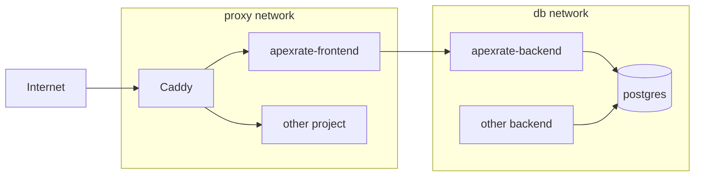

# Деплой на VDS

Схема сервера: одна общая инфраструктура на все пет-проекты и по папке на каждый проект.

```
/srv/infra/        # общий стек (deploy/infra): Caddy + один PostgreSQL
  ├── docker-compose.yaml
  ├── .env
  ├── Caddyfile
  ├── sites/*.caddy   # по файлу на проект
  └── scripts/        # create-db.sh, backup.sh
/srv/apexrate/     # этот проект: docker-compose.yaml (кладёт CI) + .env
/srv/backups/      # ежедневные дампы баз
```



- **Caddy** принимает 80/443 и сам получает HTTPS-сертификаты.
- **PostgreSQL** один инстанс; у каждого проекта своя роль и своя база, чужие базы ему недоступны (`REVOKE CONNECT ... FROM PUBLIC`). Наружу порт не открыт, только `127.0.0.1:5432` для SSH-туннеля.
- Проекты подключаются к общим Docker-сетям `proxy` (если их нужно выставить в интернет) и `db` (если нужна база).

## 1. Подготовка сервера (один раз)

Нужен Ubuntu 22.04/24.04/26.04 или Debian 12 и SSH-доступ под root по ключу.

```bash
scp deploy/server-setup.sh root@SERVER_IP:/root/
ssh root@SERVER_IP bash /root/server-setup.sh
```

Скрипт ставит Docker, создаёт пользователя `deploy` (с твоими SSH-ключами root), папки в `/srv`, включает ufw (открыты только 22/80/443) и добавляет swap, если его нет.

Образы с Docker Hub (`postgres`, `caddy`) скрипт настраивает тянуть через зеркало `mirror.gcr.io`: с российских VDS Docker Hub часто недоступен (`TLS handshake timeout` при `docker compose up`). Образы проекта лежат в `ghcr.io`, зеркало на них не влияет. Если Docker уже стоял и `/etc/docker/daemon.json` существовал, скрипт только предупредит — добавь вручную и перезапусти Docker:

```json
{
  "registry-mirrors": ["https://mirror.gcr.io"]
}
```

```bash
sudo systemctl restart docker
docker info | grep -A1 "Registry Mirrors"   # должно показать https://mirror.gcr.io/
```

Дальше всё под `deploy`: `ssh deploy@SERVER_IP`.

Рекомендуется после проверки входа под `deploy` запретить вход по паролю и root-логин в `/etc/ssh/sshd_config` (`PasswordAuthentication no`, `PermitRootLogin prohibit-password`).

## 2. Общая инфраструктура (один раз)

С локальной машины:

```bash
scp -r deploy/infra/. deploy@SERVER_IP:/srv/infra/
```

На сервере:

```bash
cd /srv/infra
cp .env.example .env
nano .env                       # ACME_EMAIL и длинный POSTGRES_PASSWORD (openssl rand -hex 32)
docker compose up -d
```

Этот стек создаёт сети `proxy` и `db`, поэтому его нужно поднять до любого проекта.

## 3. Проект ApexRate

### База

```bash
/srv/infra/scripts/create-db.sh apexrate
```

Скрипт создаст роль и базу `apexrate` и выведет готовую строку `DATABASE_URL`.

### Переменные окружения

Скопируй `deploy/apexrate.env.example` на сервер и заполни:

```bash
scp deploy/apexrate.env.example deploy@SERVER_IP:/srv/apexrate/.env
ssh deploy@SERVER_IP nano /srv/apexrate/.env    # DATABASE_URL из create-db.sh, токены
```

### Домен

1. В DNS создай A-запись домена (например `apexrate.example.com`) на IP сервера.
2. Положи конфиг сайта и перезагрузи Caddy:

```bash
scp deploy/apexrate.caddy deploy@SERVER_IP:/srv/infra/sites/
ssh deploy@SERVER_IP
nano /srv/infra/sites/apexrate.caddy             # свой домен
docker exec caddy caddy reload --config /etc/caddy/Caddyfile
```

### GitHub Actions

В репозитории: **Settings → Secrets and variables → Actions** добавь:

| Секрет        | Значение                                               |
|---------------|--------------------------------------------------------|
| `SERVER_HOST` | IP сервера                                             |
| `SERVER_USER` | `deploy`                                               |
| `SSH_KEY`     | приватный ключ, публичная часть которого есть в `~deploy/.ssh/authorized_keys` |

Лучше завести отдельный ключ под CI:

```bash
ssh-keygen -t ed25519 -f ~/.ssh/apexrate_ci -N "" -C "github-actions"
ssh-copy-id -i ~/.ssh/apexrate_ci.pub deploy@SERVER_IP
cat ~/.ssh/apexrate_ci            # это содержимое в секрет SSH_KEY
```

Если у сервера ARM-процессор, поменяй в `.github/workflows/deploy.yml` `platforms: linux/amd64` на `linux/arm64`.

### Первый деплой

Пушни в `main` или запусти workflow вручную (**Actions → Build and deploy → Run workflow**). CI соберёт образы, положит `docker-compose.prod.yaml` в `/srv/apexrate`, залогинится в GHCR временным токеном, скачает образы и поднимет контейнеры. Миграции Prisma применяются при старте бэкенда.

Проверка на сервере:

```bash
cd /srv/apexrate
docker compose ps
docker compose logs -f backend
```

## 4. Бэкапы

```bash
crontab -e
# каждый день в 03:30
30 3 * * * /srv/infra/scripts/backup.sh >> /srv/backups/backup.log 2>&1
```

Дампы всех баз лежат в `/srv/backups/<db>/`, хранятся 7 дней. Это бэкап на том же диске: периодически забирай их к себе (`rsync -a deploy@SERVER_IP:/srv/backups/ ./backups/`) или настрой выгрузку в S3.

Восстановление:

```bash
docker exec -i postgres pg_restore -U postgres -d apexrate --clean --if-exists < /srv/backups/apexrate/<файл>.dump
```

## 5. Новый проект на этом же сервере

1. `mkdir /srv/<project>` (`/srv` принадлежит `deploy`).
2. `/srv/infra/scripts/create-db.sh <project>` → `DATABASE_URL` в `/srv/<project>/.env`, хост `postgres`.
3. В compose проекта: бэкенд в сети `db`, публичный контейнер в сети `proxy`, обе `external: true`; портов не публиковать; уникальные `container_name`.
4. `/srv/infra/sites/<project>.caddy` с `reverse_proxy <container>:<port>` и `caddy reload`.

## Полезное

```bash
# Подключиться к базе из DBeaver/TablePlus: SSH-туннель, затем localhost:5432
ssh -N -L 5432:localhost:5432 deploy@SERVER_IP

# psql внутри контейнера
docker exec -it postgres psql -U postgres -d apexrate

# Откатиться на предыдущую версию
cd /srv/apexrate && TAG=<commit sha> docker compose up -d
```
